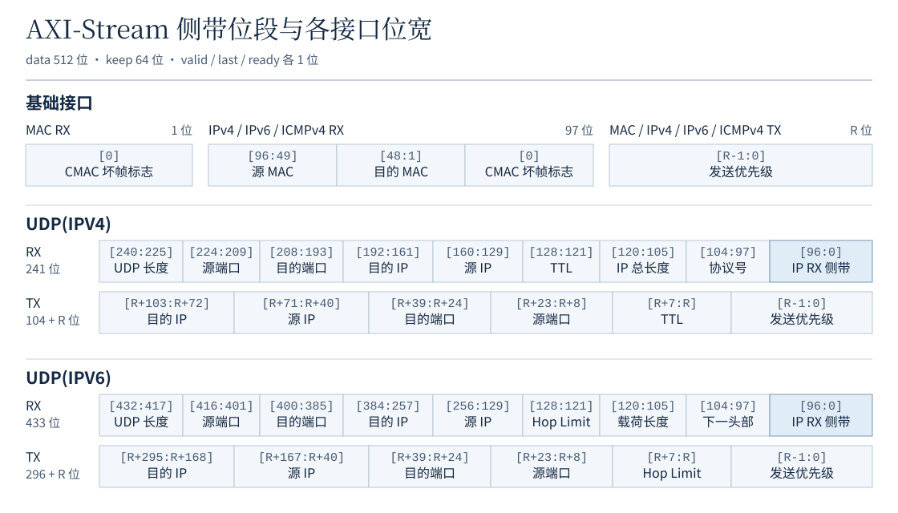

# 01 · 架构与模块

## 分层

子系统按协议层组织，自下而上四层，外加一个与 MAC 层直连的 ARP 引擎：

```text
UDP 层      —— 按目的端口区间分流与合流，组装UDP帧（挂在 IPv4 层之下）
IPv4 层     —— 按 Protocol 分流与合流，组装IPV4帧，并与ARP交互；
IPv6 层     —— 按 Next Header 分流与合流，组装IPV6帧，并与IPV6地址表交互；
MAC 层      —— 按 EtherType 分流与合流，组装MAC帧；
CMAC 硬核   —— 100G 物理层与 MAC/RS 子层（Xilinx IP）
```

**接收方向**：帧从 CMAC 进入 MAC 层，按 EtherType 分流。其中 IPv4、IPv6、ARP 是 MAC 层的内部通道：

IPv4 / IPv6 帧继续送入对应协议层，分别按 Protocol / Next Header 再次分流；ARP 帧交给 ARP 引擎处理。

IPv4 层内部又把 UDP 分出来，按目的端口区间分流。每一层的输出都是「N 条用户自定义通道 + 1 条未匹配通道」—— 未匹配通道收下所有不属于任何规则的报文，不丢包、也不堵塞其它通道。

**发送方向**：用户发送源在各层入口注入数据，逐层向下封装 ——

UDP 路径先加 UDP 头，再由 IPv4 层解析目的地址、查询 ARP 得到目的 MAC，插入 IP 头与 MAC 头；ARP查不到的帧整包丢弃并给出丢弃信号；

IPv6 路径由 IPv6 层查目的 / 源 MAC 表后插入 IPv6 头与 MAC 头，查不到的帧整包丢弃并给出丢弃信号；

MAC 自定义类型与 ARP 应答直接进入 MAC 层。MAC 层把各来源的帧调度合流、补齐最小帧长后交 CMAC 发出。

**内部通道不占用户通道**：MAC 层的 ARP / IPv4 / IPv6 与 IPv4 层的 UDP 由代码内部直连，不占用对外边界通道；对外通道数只由各层的通道数参数决定。

**发送调度**：每路发送源携带一段优先级标记（位宽可配置，默认 4 位），全 0 表示该路不参与调度；数值越大越优先，同值轮流发送，一帧发完才切换、不会中途切帧。IPv4 / IPv6 两族先各自在族内汇聚，再与 ARP、MAC 直通源一起在出口仲裁。

> **须知**：IPv6 不做邻居发现（NDP）—— ICMPv6 只是 IPv6 层可配置的一条分流通道，报文原样送达用户层，子系统不解析也不应答；IPv4 / IPv6 也不做首部校验和的计算与校验。

## 模块清单

### 协议栈（Link / Network / Transport）

| 路径 | 模块 | 功能 |
| --- | --- | --- |
| `Link/Mac/cmac_a_if.v` | `cmac_a_if` | CMAC 硬核的封装适配，收发共用；换网口时按同接口封装为 cmac_x_if |
| `Link/Mac/cmac_b_if.v` | `cmac_b_if` | CMAC 硬核的封装适配（B 口） |
| `Link/Mac/eth_frame_pad60.v` | `eth_frame_pad60` | 把不足以太网最小帧长（64 字节）的帧补齐 |
| `Link/Mac/eth_port_top.v` | `eth_port_top` | 单个网口的以太网层。接收把 CMAC 送来的帧跨到用户时钟域并交给分流器；发送汇聚各来源的帧、补齐最小帧长后交回 CMAC |
| `Link/Mac/eth_tx_mux.v` | `eth_tx_mux` | 以太网发送汇聚。按 usr 优先级在直通源与各协议族的汇总流之间调度 |
| `Link/Mac/eth_type_demux.v` | `eth_type_demux` | 以太网接收分流器。按 EtherType 分流到各通道，并自动补出一条"未匹配"通道 |
| `Network/Arp/arp_cache.v` | `arp_cache` | ARP 表项存储（多端口读写） |
| `Network/Arp/arp_cache_lookup.v` | `arp_cache_lookup` | ARP 表查表（按 IP 取 MAC / 命中标志） |
| `Network/Arp/arp_cache_subsys.v` | `arp_cache_subsys` | ARP 缓存子系统：表项缓存 + 读写端口 + 查表，供引擎例化 |
| `Network/Arp/arp_cache_write.v` | `arp_cache_write` | ARP 表写入（学习与老化更新） |
| `Network/Arp/arp_engine_top.v` | `arp_engine_top` | ARP 协议引擎。响应本机地址查询（查询与数据通路并行、不阻塞发送）、处理收到的 ARP 报文、维护地址表、管理待重发队列；支持每口多 IP、多 MAC、子网与网关 |
| `Network/Arp/arp_eth_rx.v` | `arp_eth_rx` | ARP 报文接收解析 |
| `Network/Arp/arp_eth_tx.v` | `arp_eth_tx` | ARP 报文组帧发送 |
| `Network/Arp/arp_pending_ctrl.v` | `arp_pending_ctrl` | ARP 待发队列控制（含超时与重发） |
| `Network/Icmp/icmpv4_echo_reply.v` | `icmpv4_echo_reply` | ICMPv4 回显应答（ping 响应）：交换源/目的 IP、type 8→0、增量更新 ICMP 校验和 |
| `Network/Icmp/icmpv4_type_demux.v` | `icmpv4_type_demux` | ICMP 档内两路分流：Echo Request 与其它（畸形/分片/非 echo 归 other） |
| `Network/Icmp/icmpv4_top.v` | `icmpv4_top` | ICMPv4 层顶层（薄封装）：分流 + 应答 |
| `Network/Ipv4/ipv4_arp_service.v` | `ipv4_arp_service` | 地址解析服务：帧首拍发起 ARP 查询，未命中整包丢弃且不阻塞后续帧 |
| `Network/Ipv4/ipv4_eth_header_add.v` | `ipv4_eth_header_add` | 插入 14 字节以太网首部，不改写 IPv4 头内的目的 IP |
| `Network/Ipv4/ipv4_eth_rx.v` | `ipv4_eth_rx` | 剥以太网首部，输出 IPv4 帧与侧带（源/目的 MAC） |
| `Network/Ipv4/ipv4_eth_tx.v` | `ipv4_eth_tx` | IPv4 帧封装为以太网帧：查 ARP 结果并插头，不做最小帧长补齐 |
| `Network/Ipv4/ipv4_proto_demux.v` | `ipv4_proto_demux` | IPv4 接收分流器：按 Protocol 字段分流，未匹配进 other 兜底通道 |
| `Network/Ipv4/ipv4_top.v` | `ipv4_top` | IPv4 层顶层。接收剥以太头、按协议号分流；发送解析目的地址、查 ARP 并插入 MAC 头 |
| `Network/Ipv4/ipv4_tx_mux.v` | `ipv4_tx_mux` | IPv4 族内发送汇聚，按 usr 优先级仲裁 |
| `Network/Ipv6/ipv6_eth_header_add.v` | `ipv6_eth_header_add` | 插入 14 字节以太网首部 |
| `Network/Ipv6/ipv6_eth_rx.v` | `ipv6_eth_rx` | 剥以太网首部，输出 IPv6 帧与侧带（源/目的 MAC） |
| `Network/Ipv6/ipv6_eth_tx.v` | `ipv6_eth_tx` | IPv6 帧封装为以太网帧：查 MAC 表并插头 |
| `Network/Ipv6/ipv6_mac_lookup.v` | `ipv6_mac_lookup` | IPv6 目的/源 MAC 地址表查找（仅首拍有效） |
| `Network/Ipv6/ipv6_proto_demux.v` | `ipv6_proto_demux` | IPv6 接收分流器：按 Next Header 字段分流 |
| `Network/Ipv6/ipv6_top.v` | `ipv6_top` | IPv6 层顶层。接收剥以太头、按下一头部类型分流；发送查目的/源 MAC 表并封装，查不到的帧整包丢弃并给出标记 |
| `Network/Ipv6/ipv6_tx_mux.v` | `ipv6_tx_mux` | IPv6 族内发送汇聚，按 usr 优先级仲裁 |
| `Transport/Udp/Ipv4/udp_header_add.v` | `udp_header_add` | 插入 8 字节 UDP 首部 |
| `Transport/Udp/Ipv4/udp_header_strip.v` | `udp_header_strip` | 剥离 8 字节 UDP 首部，首部字段追加到 usr |
| `Transport/Udp/Ipv4/udp_ipv4_header_add.v` | `udp_ipv4_header_add` | 插入 20 字节 IPv4 首部（TTL/IP 取自 usr，头校验和内部逐包计算） |
| `Transport/Udp/Ipv4/udp_ipv4_len_checksum.v` | `udp_ipv4_len_checksum` | 计算 UDP 长度与校验和（含 IPv4 伪首部），随包首拍送出侧带信息 |
| `Transport/Udp/Ipv4/udp_ipv4_port_demux.v` | `udp_ipv4_port_demux` | UDP 接收分流器：按目的端口区间分流 |
| `Transport/Udp/Ipv4/udp_ipv4_rx.v` | `udp_ipv4_rx` | 剥 IPv4 首部，交付 UDP 报文与侧带信息 |
| `Transport/Udp/Ipv4/udp_ipv4_top.v` | `udp_ipv4_top` | UDP 层顶层。接收剥 IP 头、按目的端口区间分流；发送汇聚各路并加 UDP 头，交 IPv4 层继续封装 |
| `Transport/Udp/Ipv4/udp_ipv4_tx.v` | `udp_ipv4_tx` | UDP 发送链容器：算长度/校验和 → 插 UDP 头 → 插 IPv4 头 → 出口寄存 |
| `Transport/Udp/Ipv4/udp_ipv4_tx_mux.v` | `udp_ipv4_tx_mux` | UDP 各路发送汇聚，按 usr 优先级仲裁 |

### 通用件（Algorithm / Bsp）

| 路径 | 模块 | 功能 |
| --- | --- | --- |
| `Algorithm/arbiter.v` | `arbiter` | 基于 priority_encoder 的 N 选 1 仲裁器（轮询 / 严格优先级） |
| `Algorithm/arbiter_by_val.v` | `arbiter_by_val` | 按值优先、同值轮询的仲裁器（usr 数值越大越优先，0 表示不参与） |
| `Algorithm/crc32.v` | `crc32` | CRC32 计算（以太网 FCS 口径） |
| `Algorithm/lfsr.v` | `lfsr` | 线性反馈移位寄存器 |
| `Algorithm/priority_encoder.v` | `priority_encoder` | 优先级编码器（仲裁器的基础件） |
| `Bsp/Axis/axis_n_to_1.v` | `axis_n_to_1` | N 路 AXI-Stream 汇聚为 1 路（按通道号轮询） |
| `Bsp/Axis/axis_n_to_1_by_val.v` | `axis_n_to_1_by_val` | N 路 AXI-Stream 汇聚为 1 路（按 usr 数值仲裁，是各级 tx_mux 的共用实现） |
| `Bsp/Bram/sdp_bram.v` | `sdp_bram` | 单时钟简单双口块 RAM（独立读写、可选旁路） |
| `Bsp/Bram/sp_bram.v` | `sp_bram` | 单口块 RAM |
| `Bsp/Bram/tdp_bram.v` | `tdp_bram` | 真双口块 RAM |
| `Bsp/Fifo/axis_fifo_async.v` | `axis_fifo_async` | 异步 AXI-Stream FIFO（跨时钟域，可选整包模式） |
| `Bsp/Fifo/axis_fifo_sync.v` | `axis_fifo_sync` | 单时钟 AXI-Stream FIFO（可选整包模式） |
| `Bsp/Fifo/fifo_sync.v` | `fifo_sync` | 单时钟 FIFO，支持可选分布式/块 RAM 与输出寄存级数 |
| `Bsp/Skid/axis_skid_buffer.v` | `axis_skid_buffer` | AXI-Stream 版 skid buffer |
| `Bsp/Skid/skid_buffer.v` | `skid_buffer` | 单拍 skid buffer，阻断下游 ready 反压传递 |

### 顶层与验证环境（Top / Test）

| 路径 | 模块 | 功能 |
| --- | --- | --- |
| `Top/net_stack_top.v` | `net_stack_top` | 协议栈顶层（Link + Network + Transport）。按网口数逐口生成完整收发通路，并对每口的通道数、分发规则等配置统一解包 |
| `Test/Top/cmac_test_top.v` | `cmac_test_top` | 板级验证顶层：仅 CMAC 收发通路，用于核对物理层链路 |
| `Test/Top/ipv4_test_top.v` | `ipv4_test_top` | 板级验证顶层：单口 IPv4 收发链路 + 打流机 |
| `Test/Top/subsys_test_top.v` | `subsys_test_top` | 板级验证顶层：双网口交叉对接、每口挂 5 台打流机，用于上板打流与时序收敛验证 |
| `Test/eth_100g_tester.v` | `eth_100g_tester` | 100G 以太网打流机：极限测速 + 误码校验（发包机 + 校验机） |
| `Test/ipv4_100g_tester.v` | `ipv4_100g_tester` | IPv4 打流机：构造 IPv4 报文做吞吐与误码校验 |
| `Test/subsys_100g_tester.v` | `subsys_100g_tester` | 全栈打流机：按端口/优先级构造多协议流量，验证调度与吞吐 |


## 性能与吞吐

### 已达到的性能

- 全流水线、无气泡：**200 MHz 与 400 MHz 两种用户时钟下均实测跑满 100G 线速**（分阶段实测记录见 [04 · 验证与测试](04-verification.md)）；
- 地址解析不阻塞发送：ARP 查询与数据通路并行，IPv4 帧封装为 MAC 帧时不产生等待拍，相邻帧可背靠背连续发送。

### 线速计算

用户逻辑统计到的是 AXI-Stream 上的字节吞吐。以太网线上每帧还要多 24 字节开销（前导码与起始符 8 + FCS 4 + 帧间隔 12），且 CMAC 配置为发送插入 FCS、接收剥离 FCS，所以总线上的帧不含 FCS：

```text
线速 = 总线（AXIS）吞吐 × (L + 额外长度) / L   （L = 单帧 AXIS 字节数）

额外长度按层次取：MAC 帧 +24（前导码/SFD 8 + FCS 4 + IFG 12）；IPv4 / IPv6 帧 +38（再加 14 字节以太网首部）；
UDP 载荷 +66（= 24 + 14 以太网 + 20 IPv4 + 8 UDP；打流机只发载荷）。
```

1024 字节帧 ⇒ 系数 `1048 / 1024 = 1.0234`，即 **100G 线速只要求总线侧 97.7 Gbps**；

### 用户时钟

| 用户时钟    | 512 位总线容量  | 100G 线速所需占用 |
| ------- | ---------- | ----------- |
| 200 MHz | 102.4 Gbps | 约 95.4%     |
| 400 MHz | 204.8 Gbps | 约 47.7%     |

CMAC 侧 GT 用户时钟固定为 322.269 MHz（容量 165.0 Gbps，占用约 59.2%），由 CMAC IP 决定，无需配置。

- 200 MHz 足够跑满 100G 线速，但余量不足 5% —— 任何成规模的气泡都会立刻把吞吐拉到线速以下，因此它也是检验自己集成是否引入气泡的灵敏配置，实际代码架构支持无气泡设计，唯一损耗在跨时钟域转换的FIFO边界时可能引入的空拍；
- 400 MHz 余量充足，支持后续用户逻辑插入大量气泡，短帧为主的场景开销占比更大，请按实际帧长用上式重算。

## 边界接口命名

| 前缀            | 方向 | 说明                                    |
| ------------- | -- | ------------------------------------- |
| `*_axis_m*`   | 输出 | 子系统 → 用户（接收）                          |
| `*_axis_s*`   | 输入 | 用户 → 子系统（发送）                          |
| `*_axis_susr` | 输入 | 每路一段优先级标记，位宽 = `ARBITER_VAL_WIDTH`（默认 4）；**例外**：UDP TX 通道为 108 位每包元数据（见下节） |

## usr 字段含义

接收方向的 `usr`（AXI-Stream 的 TUSER）随协议逐层解析而扩充，承载各层解析出的报文信息；发送方向的 `usr` 大多数通道仍是每路一段优先级标记（位宽 = `ARBITER_VAL_WIDTH`），唯 UDP TX 通道为 108 位每包元数据（见下）。接收方向各层的 `usr` 位段定义如下图（每通道独享一份；位段记作 `[MSB:LSB]`）：



- **MAC 层**（`mac_axis_musr`，`MAC_RX_USR_WIDTH` 位/通道，默认 1）：帧错误标志 —— `1` 表示接收帧有错误，`0` 表示接收帧有效；
- **IPv4 / IPv6 层**（`ipv4_axis_musr` / `ipv6_axis_musr`，`IPV4_RX_USR_WIDTH` / `IPV6_RX_USR_WIDTH` 位/通道，默认 97）：源 / 目的 MAC（各 48 位，从以太网首部解析）+ MAC 层错误标志原样带入；
- **UDP 层**（`udp_axis_musr`，`UDP_RX_USR_WIDTH` 位/通道，默认 241）：目的 / 源 UDP 端口、UDP 长度、目的 / 源 IP、TTL、IP 总长、协议号 + IPv4 层 usr 原样带入。
  UDP 首部字段由 `udp_header_strip` 在剥掉 8 字节首部的同时解析并**追加到 usr 高位**（校验和不上送）：`[+47:+32]` udp_len、`[+31:+16]` src_port、`[+15:+0]` dst_port；
  对应地，`udp_axis_m*` 交付给用户的是**纯净载荷**（既无 IPv4 首部也无 UDP 首部），与 `udp_axis_s*` 的"载荷进"约定对称。

上述位宽在 `net_stack_top` 顶层集中定义为常量并按推导式表达，逐层向下透传（`*_RX_USR_WIDTH` 传参给各层顶层与 demux；TX 侧 `*_TX_USR_WIDTH` 默认等于 `ARBITER_VAL_WIDTH`，UDP TX 为 108 位元数据）：

```verilog
localparam MAC_RX_USR_WIDTH  = 1;
localparam IPV4_RX_USR_WIDTH = 48 + 48 + MAC_RX_USR_WIDTH;          // 97
localparam IPV6_RX_USR_WIDTH = IPV4_RX_USR_WIDTH;                   // 97
localparam UDP_RX_USR_WIDTH  = IPV4_RX_USR_WIDTH + 32+32+8+16+8 + 16+16+16; // 241
localparam UDP_TX_USR_WIDTH  = 4 + 8 + 16 + 16 + 32 + 32;           // 108
```

**发送方向 UDP TX 通道** 的 `usr`（`udp_axis_susr`）为 108 位每包元数据，优先级必须落在最低 **ARBITER_VAL_WIDTH** 位（`axis_n_to_1_by_val` 只取低 `ARBITER_VAL_WIDTH` 位仲裁，其余位原样透传）。三个模块（`udp_ipv4_len_checksum` / `udp_header_add` / `udp_ipv4_header_add`）按同一份布局切片：

| 位段         | 字段       | 说明                                                         |
| ---------- | -------- | ---------------------------------------------------------- |
| `[3:0]`    | priority | 仲裁值，`0` 表示该通道关闭；UDP 取 8                              |
| `[11:4]`   | ttl      | IPv4 头 TTL                                                   |
| `[27:12]`  | src_port | 源端口，小端值（端口 `0x1234` 写 `16'h3412`）                        |
| `[43:28]`  | dst_port | 目的端口，小端值                                                 |
| `[75:44]`  | src_ip   | 源 IP，小端值（`192.168.1.100` 写 `32'h6401A8C0`）                 |
| `[107:76]` | dst_ip   | 目的 IP，小端值                                                  |

`usr` 必须整包恒定；IPv4 头插入完成后该元数据已全部落入报文，`udp_ipv4_tx` 出口裁回 **ARBITER_VAL_WIDTH** 位优先级（后续 `ipv4_tx_mux` / ARP / MAC 层均维持 **ARBITER_VAL_WIDTH** 位，不受影响）。
