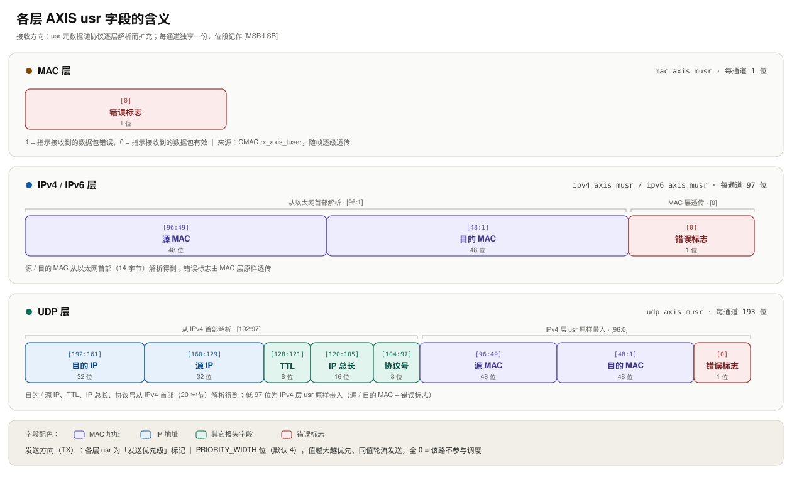

# 01 · 架构与模块

## 分层

子系统按协议层组织，自下而上四层，外加一个与 MAC 层直连的 ARP 引擎：

```text
UDP 层      —— 按目的端口区间分流与合流，组装UDP帧（挂在 IPv4 层之下）
IPv4 层     —— 按 Protocol 分流与合流，组装IPV4帧，并与ARP交互；
IPv6 层     —— 按 Next Header 分流与合流，组装IPV6帧，并与IPV6地址表交互；
MAC 层      —— 按 EtherType 分流与合流，组装MAC帧；
CMAC 硬核   —— 100G 物理层与 MAC/RS 子层（Xilinx IP）
```

**接收方向**：帧从 CMAC 进入 MAC 层，按 EtherType 分流。其中 IPv4、IPv6、ARP 是 MAC 层的内部通道：

IPv4 / IPv6 帧继续送入对应协议层，分别按 Protocol / Next Header 再次分流；ARP 帧交给 ARP 引擎处理。

IPv4 层内部又把 UDP 分出来，按目的端口区间分流。每一层的输出都是「N 条用户自定义通道 + 1 条未匹配通道」—— 未匹配通道收下所有不属于任何规则的报文，不丢包、也不堵塞其它通道。

**发送方向**：用户发送源在各层入口注入数据，逐层向下封装 ——

UDP 路径先加 UDP 头，再由 IPv4 层解析目的地址、查询 ARP 得到目的 MAC，插入 IP 头与 MAC 头；ARP查不到的帧整包丢弃并给出丢弃信号；

IPv6 路径由 IPv6 层查目的 / 源 MAC 表后插入 IPv6 头与 MAC 头，查不到的帧整包丢弃并给出丢弃信号；

MAC 自定义类型与 ARP 应答直接进入 MAC 层。MAC 层把各来源的帧调度合流、补齐最小帧长后交 CMAC 发出。

**内部通道不占用户通道**：MAC 层的 ARP / IPv4 / IPv6 与 IPv4 层的 UDP 由代码内部直连，不占用对外边界通道；对外通道数只由各层的通道数参数决定。

**发送调度**：每路发送源携带一段优先级标记（位宽可配置，默认 4 位），全 0 表示该路不参与调度；数值越大越优先，同值轮流发送，一帧发完才切换、不会中途切帧。IPv4 / IPv6 两族先各自在族内汇聚，再与 ARP、MAC 直通源一起在出口仲裁。

> **须知**：IPv6 不做邻居发现（NDP）—— ICMPv6 只是 IPv6 层可配置的一条分流通道，报文原样送达用户层，子系统不解析也不应答；IPv4 / IPv6 也不做首部校验和的计算与校验。

## 模块清单

### Eth —— 以太网子系统

| 模块                                                                                   | 功能                                                                                  |
| ------------------------------------------------------------------------------------ | ----------------------------------------------------------------------------------- |
| `eth_subsys_top.v`                                                                   | 子系统顶层。按网口数逐口生成完整收发通路，并对每口的通道数、分发规则等配置统一解包                                           |
| `MAC/eth_top.v`                                                                      | 单个网口的以太网层。接收方向把 CMAC 送来的帧跨到用户时钟域并交给分流器；发送方向汇聚各来源的帧、补齐最小帧长后交回 CMAC                   |
| `MAC/eth_type_demux.v`                                                               | 以太网接收分流器。按 EtherType 分流到各通道，并自动补出一条"未匹配"通道                                          |
| `MAC/eth_tx_mux.v`                                                                   | 以太网发送汇聚。按优先级在直通源与各协议族的汇总流之间调度                                                       |
| `MAC/cmac_a_if.v` / `cmac_b_if.v`                                                    | CMAC 硬核的封装适配，收发共用，一个网口使用一份，如需拓展或更换网口IP，可以将接口封装为`cmac_x_if.v`                        |
| `MAC/eth_frame_pad60.v`                                                              | 把不足以太网最小帧长（64 字节）的帧补齐                                                               |
| `Ipv4/ipv4_top.v`                                                                    | IPv4 层顶层。接收方向剥以太网头、按协议号分流；发送方向解析目的地址、查询 ARP 并插入 MAC 头                               |
| `Ipv4/ipv4_type_demux.v` / `ipv4_tx_mux.v` / `ipv4_mac_add.v` / `ipv4_arp_service.v` | IPv4 的接收分流、族内发送汇聚、MAC 头插入与地址解析服务                                                    |
| `Ipv6/ipv6_top.v`                                                                    | IPv6 层顶层。接收方向剥以太网头、按下一头部类型分流；发送方向查目的 / 源 MAC 表并封装，查不到的帧整包丢弃并给出标记                    |
| `Ipv6/ipv6_mac_lookup.v`                                                             | IPv6 目的 / 源 MAC 地址表查找                                                               |
| `Udp/udp_top.v`                                                                      | UDP 层顶层。接收方向剥 IP 头、按目的端口区间分流；发送方向汇聚各路并加 UDP 头，交 IPv4 层继续封装                          |
| `Arp/arp_engine_top.v`                                                               | ARP 协议引擎。响应本机的地址查询（查询与数据通路并行，不阻塞发送）、处理收到的 ARP 报文、维护地址表、管理待重发队列；支持每口多 IP、多 MAC、子网与网关 |
| `Arp/` 其余模块                                                                          | ARP 表项缓存、查表、待发队列（含超时）与应答组帧                                                          |

### Algorithm / Bsp —— 通用件

| 模块                                                                   | 功能                               |
| -------------------------------------------------------------------- | -------------------------------- |
| `Algorithm/arbiter_by_val.v`                                         | 按值优先、同值轮询的仲裁器                    |
| `Algorithm/arbiter.v` / `priority_encoder.v` / `crc_32.v` / `lfsr.v` | 通用仲裁、优先级编码、CRC32 与伪随机序列          |
| `Bsp/Axis/axis_nto1.v` / `axis_nto1_by_val.v`                        | AXI-Stream 多路到一路的汇聚，全部发送汇聚共用同一实现 |
| `Bsp/Fifo/*` / `Bsp/Bram/*` / `Bsp/Skid/*`                           | 同步与异步 FIFO、BRAM 封装、抗背压缓冲         |

## 性能与吞吐

### 已达到的性能

- 全流水线、无气泡：**200 MHz 与 400 MHz 两种用户时钟下均实测跑满 100G 线速**（分阶段实测记录见 [04 · 验证与测试](04-verification.md)）；
- 地址解析不阻塞发送：ARP 查询与数据通路并行，IPv4 帧封装为 MAC 帧时不产生等待拍，相邻帧可背靠背连续发送。

### 线速计算

用户逻辑统计到的是 AXI-Stream 上的字节吞吐。以太网线上每帧还要多 24 字节开销（前导码与起始符 8 + FCS 4 + 帧间隔 12），且 CMAC 配置为发送插入 FCS、接收剥离 FCS，所以总线上的帧不含 FCS：

```text
线速 = 总线（AXIS）吞吐 × (L + 额外长度) / L   （L = 单帧 AXIS 字节数）

额外长度按层次取：MAC 帧 +24（前导码/SFD 8 + FCS 4 + IFG 12）；IPv4 / IPv6 帧 +38（再加 14 字节以太网首部）；
UDP 载荷 +58（再加 20 字节 IPv4 首部与 8 字节 UDP 首部）。
```

1024 字节帧 ⇒ 系数 `1048 / 1024 = 1.0234`，即 **100G 线速只要求总线侧 97.7 Gbps**；

### 用户时钟

| 用户时钟    | 512 位总线容量  | 100G 线速所需占用 |
| ------- | ---------- | ----------- |
| 200 MHz | 102.4 Gbps | 约 95.4%     |
| 400 MHz | 204.8 Gbps | 约 47.7%     |

CMAC 侧 GT 用户时钟固定为 322.269 MHz（容量 165.0 Gbps，占用约 59.2%），由 CMAC IP 决定，无需配置。

- 200 MHz 足够跑满 100G 线速，但余量不足 5% —— 任何成规模的气泡都会立刻把吞吐拉到线速以下，因此它也是检验自己集成是否引入气泡的灵敏配置，实际代码架构支持无气泡设计，唯一损耗在跨时钟域转换的FIFO边界时可能引入的空拍；
- 400 MHz 余量充足，支持后续用户逻辑插入大量气泡，短帧为主的场景开销占比更大，请按实际帧长用上式重算。

## 边界接口命名

| 前缀            | 方向 | 说明                                    |
| ------------- | -- | ------------------------------------- |
| `*_axis_m*`   | 输出 | 子系统 → 用户（接收）                          |
| `*_axis_s*`   | 输入 | 用户 → 子系统（发送）                          |
| `*_axis_susr` | 输入 | 每路一段优先级标记，位宽 = `PRIORITY_WIDTH`（默认 4） |

## usr 字段含义

接收方向的 `usr`（AXI-Stream 的 TUSER）随协议逐层解析而扩充，承载各层解析出的报文信息；发送方向的 `usr` 是每路的发送优先级标记（位宽与调度规则见上文「发送调度」）。接收方向各层的 `usr` 位段定义如下图（每通道独享一份；位段记作 `[MSB:LSB]`）：



- **MAC 层**（`mac_axis_musr`，1 位/通道）：帧错误标志 —— `1` 表示接收帧有错误，`0` 表示接收帧有效；
- **IPv4 / IPv6 层**（`ipv4_axis_musr` / `ipv6_axis_musr`，97 位/通道）：源 / 目的 MAC（各 48 位，从以太网首部解析）+ MAC 层错误标志（1 位）；
- **UDP 层**（`udp_axis_musr`，193 位/通道）：目的 / 源 IP、TTL、IP 总长、协议号（共 96 位，从 IPv4 首部解析）+ IPv4 层 97 位原样带入。
