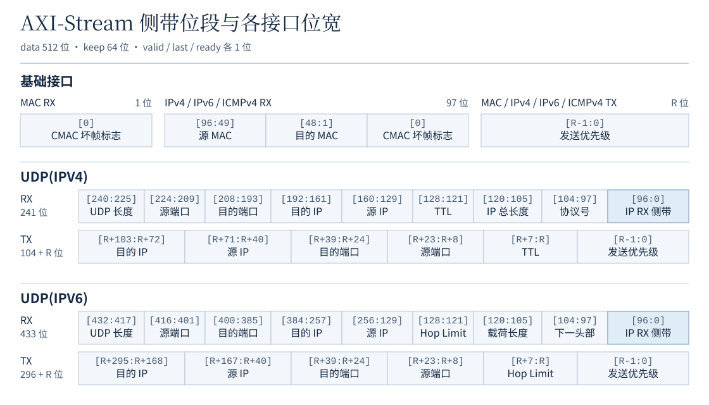

# 集成指南

单口集成例化 `eth_stack_port`，双口接线参考 `eth_stack_top`。 [单口接口](../RTL/Top/eth_stack_port.v) · [双口封装](../RTL/Top/eth_stack_top.v) · [参考板接线](../RTL/Test/Top/subsys_test_top.v)

## 1. 接时钟、复位和物理口

| 信号或参数 | 接法 |
| --- | --- |
| `CmacSelect` | `0` 选 A 侧 CMAC，`1` 选 B 侧。核对四条 GT lane、差分参考时钟和 QSFP 控制脚 |
| `init_clk`、`InitClkFreqHz` | 接初始化时钟，参数填实际频率（Hz）。参考设计使用 100 MHz |
| `clk`、`ClkFreqHz` | 接业务时钟，参数填实际频率（Hz）。双口参考设计使用 400 MHz |
| `clk_locked`、`rst` | 接业务时钟锁定信号，复位高有效并在 `clk` 域同步释放 |

参考 CMAC 的 GT 参考时钟为 322.265625 MHz。更换板卡时，一起核对 CMAC XCI、目标板原理图和 XDC。

## 2. 接业务 AXI-Stream

- `*_axis_m*` 是协议栈送给业务的 RX，`*_axis_s*` 是业务送给协议栈的 TX。每路 `data` 为 512 位，`keep` 为 64 位，`valid`、`ready`、`last` 各 1 位。
- 第 `i` 路取 `data[i*512 +: 512]`、`keep[i*64 +: 64]`、控制位 `[i]` 和 `usr[i*W +: W]`，其中 `W` 为单路 `usr` 位宽。
- 未用的 RX 路（含兜底档）将 `ready` 置 1。未用的 TX 路将 `valid` 置 0，并给其余输入确定值。

### usr 位段



业务 RX 输出、TX 输入均为本层载荷。RX 的 `usr` 为 `{本层首部, 上游usr}`，最低位为末拍坏帧标志；UDP/ICMP TX 的 `usr` 从高到低为 `{本层首部64位, IP首部, 优先级R位}`。

图中 `R` 为发送优先级位宽，参考值为 4。优先级为 0 时不参与仲裁，数值越大越优先。MAC RX 在 `valid && ready && last` 时读取坏帧标志，值为 1 表示坏帧。

多字节地址、端口和长度字段的首个线上字节放在字段低 8 位。例如端口 2 的线上字节是 `00 02`，写入对应侧带字段时用 `16'h0200`。

IPv4 首部校验和由协议栈填写；IPv4/IPv6 业务 TX 需提供正确的 IP 长度。UDP 和 ICMPv4/v6 通路自动填写长度及校验和，ICMPv4、ICMPv6 载荷最多 32768 字节。FCS 由 CMAC 生成。

下例为单路 UDP(IPV4) TX 的 `usr`。业务数据口给 UDP 载荷，A 口 `192.168.1.18` 发往 B 口 `192.168.1.145`，目的端口为 2，源端口为 4660。

```verilog
localparam [227:0] UDP_TX_USR = {
    {16'd0, 16'd0, 16'h0200, 16'h3412}, // UDP：校验和、长度、目的端口、源端口
    {32'h9101_a8c0, 32'h1201_a8c0,      // IPv4：目的地址、源地址
     16'd0, 8'd17, 8'd64,              // 校验和、Protocol、TTL
     16'h0040, 16'd0, 16'd0, 8'd0, 8'h45},
    4'd8                              // 发送优先级
};
```

保留参考 A/B 地址和分流设置时，用上面的侧带发送已知载荷。待 ARP 解析后再发一帧，确认 B 口业务档 0 收到相同载荷，且目的端口字段为 `16'h0200`。

## 3. 检查实现约束

使用自己的顶层时，把建工程命令中的 `-top subsys_test_top` 换成模块名。`-xdc my_board` 选择 `XDC/my_board.xdc`，并加载同名的 `my_board_impl.xdc`（如有）。

运行实现前，核对目标板的引脚、时钟和布局约束。手动建工程时，在 `impl_1` 的 `OPT_DESIGN` 前置 Tcl 脚本中指定 FIFO 约束加载器。建工程脚本会自动设置该项。 [参考板 XDC](../XDC/subsys_test_top.xdc) · [实现 XDC](../XDC/subsys_test_top_impl.xdc) · [FIFO 约束加载器](../RTL/Bsp/Fifo/load_fifo_async_constraints.tcl)
