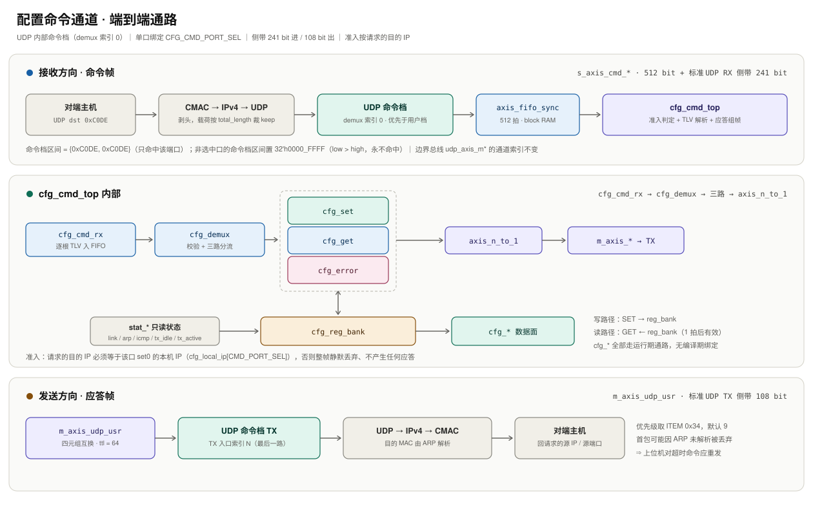

# 05 · 配置命令通道

## 通道结构

命令通道是 **UDP 内部档**，不是用户可配的通道：它在 `udp_ipv4_port_demux` 里占**索引 0**，排在所有用户档之前，因此**不占用用户通道名额**、也不出现在用户分流表里。对外边界总线 `udp_axis_m*` 的通道索引不变。



| 环节 | 说明 |
| --- | --- |
| 承载端口 | 默认 UDP `0xC0DE`（每口一份，可由 ITEM `0x33` 改） |
| 绑定网口 | `CFG_CMD_PORT_SEL`（`cfg_map.vh`，4 bit，默认 `0`）；未选中的口把命令档区间置 `32'h0000_FFFF`（`low > high`），永不命中 |

**准入**：请求的**目的 IP** 必须等于绑定网口 set0 的本机 IP（`cfg_local_ip[CFG_CMD_PORT_SEL]`）。

## 请求帧

一帧由**若干根 TLV 首尾相连**组成，没有独立的帧头。**每根 TLV 自带 `OP` 和 `SEQ`**，所以一帧里可以混用不同操作、不同序号。


| 字段 | 宽度 | 说明 |
| --- | --- | --- |
| `OP` | 1 B | 操作码，见下节 |
| `SEQ` | 1 B | 序列号，应答原样回显，供上位机匹配 |
| `TAG` | 2 B | `TAG[7:0]` = ITEM；`TAG[11:8]` = PORT；`TAG[15:12]` = SET |
| `LEN` | 1 B | VALUE 字节数，`0 ~ 16` |
| `VALUE` | `LEN` B | 值；地址类用**网络序**，数值类用**小端**（见「字节序」一节）；`LEN = 0` 时整体省略 |

单根 TLV 占 `5 + LEN` 字节（`OP` 1 + `SEQ` 1 + `TAG` 2 + `LEN` 1 + `VALUE` `LEN`）。

一帧两条 TLV（先读版本，再把口 0 的子网掩码改成 `255.255.0.0`）的字节流：

```text
02 01 51 00 00                            GET  0x51(VER)  port0 set0  LEN=0
01 02 03 00 04 FF FF 00 00                SET  0x03(MASK) port0 set0  LEN=4  VAL=0x0000FFFF
```

## 操作码与状态码

| 值 | 名称 | 方向 | 说明 |
| --- | --- | --- | --- |
| `0x01` | SET | 请求 | 写配置 / 触发动作 |
| `0x02` | GET | 请求 | 读配置 / 读状态 |
| `0x81` | SET_RSP | 应答 | SET 成功（`STATUS` 恒 `0x00`） |
| `0x82` | GET_RSP | 应答 | GET 成功（`STATUS` 恒 `0x00`） |
| `0x8F` | ERR_RSP | 应答 | 请求被拒绝，`STATUS` 给出原因 |

> 失败一律走 `ERR_RSP`：SET 被拒也回 `0x8F`，不会出现 `STATUS ≠ 0` 的 `0x81`。

`STATUS` 在三路应答里都有：

| 值 | 名称 | 含义 |
| --- | --- | --- |
| `0x00` | OK | 成功 |
| `0x01` | BAD_OP | `OP` 不是 `0x01` / `0x02` |
| `0x02` | BAD_ITEM | ITEM 编号未定义 |
| `0x03` | BAD_SET | SET / 档索引越界（超过该口该 item 的份数） |
| `0x04` | BAD_PORT | PORT ≥ `ETH_PORT_NUM` |
| `0x05` | BAD_LEN | `LEN` 越界，或 SET 的 `LEN` 与该 ITEM 期望宽度不符 |
| `0x06` | WRITE_ONLY | 对**不可读**的项发 GET（动作类 `0x40 ~ 0x43`）——该项只写 |
| `0x07` | READ_ONLY | 对**不可写**的项发 SET（`0x51 ~ 0x72`）——该项只读 |

校验顺序固定，**命中第一个错误即返回**：

```text
OP → ITEM → SET → PORT → LEN → 读写权限
```

## ITEM 表

类型：**RW** 可读写、**W** 写only（动作）、**R** 读only。「口0 / 口1」是默认配置下的份数，运行期以 `GEOMETRY` 读回的为准。

### 地址类（RW，带 SET 维度）

| ITEM | 名称 | 值宽 | 口0 / 口1 | 说明 |
| --- | --- | --- | --- | --- |
| `0x00` | IPV4_LOCAL_IP | 4 B | 1 / 1 | 本机 IPv4 地址 |
| `0x01` | IPV4_LOCAL_MAC | 6 B | 1 / 1 | 本机 MAC |
| `0x02` | IPV4_GATEWAY | 4 B | 1 / 1 | 网关 |
| `0x03` | IPV4_MASK | 4 B | 1 / 1 | 子网掩码 |
| `0x04` | IPV6_SRC_LOCAL | 16 B | 2 / 2 | 本机 IPv6 地址 |
| `0x05` | IPV6_SRC_MAC | 6 B | 2 / 2 | 本机 IPv6 对应 MAC |
| `0x06` | IPV6_DST_LOCAL | 16 B | 2 / 2 | 邻居 IPv6 地址 |
| `0x07` | IPV6_DST_MAC | 6 B | 2 / 2 | 邻居 IPv6 对应 MAC |

`0x00 ~ 0x03` 共用同一套索引；`0x04 / 0x05` 共用一套，`0x06 / 0x07` 共用一套。

> 改本机 IP 后需要发 GARP，否则同网段的邻居 ARP 缓存仍是旧地址。改 MAC 不涉及 GT / PCS / CMAC 的重配，但要同时改 IPv4 的 `0x01` 和 IPv6 的 `0x05`。

### 分流规则（RW，带 SET 维度）

| ITEM | 名称 | 值宽 | 口0 / 口1 | 说明 |
| --- | --- | --- | --- | --- |
| `0x10` | ETH_TYPE_DICT | 2 B | 2 / 1 | 用户自定义以太类型 |
| `0x11` | IPV4_PROTO_DICT | 1 B | 3 / 3 | IPv4 协议号 |
| `0x12` | IPV6_NH_DICT | 1 B | 3 / 3 | IPv6 下一首部号 |
| `0x13` | UDP_PORT_RANGE | 4 B | 3 / 2 | UDP 目的端口区间 `{高 16b, 低 16b}` |

写进去的是「该档认什么关键字」，改完立刻对新到的帧生效。关键字按**小端**书写：以太类型 `0x88B5` 写 `16'hB588`（本组全是数值类，不涉及地址类的网络序规则）。

### 行为参数（RW，每口一份，无 SET 维度）

| ITEM | 名称 | 值宽 | 说明 |
| --- | --- | --- | --- |
| `0x30` | PENDING_TIME | 8 B | ARP 等待超时，**低 57 位有效**，单位 = 用户时钟周期（400 MHz 下 1 s ≈ `400_000_000`） |
| `0x31` | ARP_PRIO | 1 B | ARP 内部帧发送优先级，取**低 4 位**；`0` = 禁用（ARP 不再发应答） |
| `0x32` | ICMP_PRIO | 1 B | ICMPv4 echo 应答优先级，取**低 4 位**；`0` = 禁用 |
| `0x33` | CMD_UDP_PORT | 2 B | 命令通道自身的 UDP 端口（**数值**，默认 `0xC0DE`） |
| `0x34` | CMD_UDP_PRIO | 1 B | 命令应答的发送优先级，取低 4 位，默认 `9`；`0` = 禁用 |

> `0x33` / `0x34` 改的是这条通道自己：端口改错会**再也连不上**，优先级改成 `0` 会让应答发不出去。上位机改这两项前应先确认能回滚（例如同时下发一条带旧端口的兜底命令，或准备复位默认）。

### 动作（W，写only，`LEN = 0`）

| ITEM | 名称 | 作用域 | 说明 |
| --- | --- | --- | --- |
| `0x40` | RESET_DEF | 全局 | 恢复全部默认值 |
| `0x41` | CACHE_CLEAR | 每口 | 清 ARP 缓存表 |
| `0x42` | PEND_CLEAR | 每口 | 清 ARP 等待队列 |
| `0x43` | STAT_CLEAR | 每口 | 清锁存统计（`0x60` / `0x61`） |

这四个不校验 `LEN`（传 `0` 即可）。`RESET_DEF` 会把地址、命令端口、优先级一起复位。

### 状态（R，读only）

| ITEM | 名称 | 值宽 | 作用域 | 说明 |
| --- | --- | --- | --- | --- |
| `0x51` | VERSION | 4 B | 全局 | `0x0001_0100` = `{主, 次, 构建, 协议}` |
| `0x52` | LINK_STATUS | 1 B | 每口 | bit0 = 1 表示链路可用 |
| `0x53` | TX_IDLE | 1 B | 每口 | bit0 = 1 表示该口发送侧空闲 |
| `0x54` | TX_ACTIVE | 1 B | 每口 | 低 `TX_IDX_WIDTH` 位（默认 3）= 当前被服务的发送源索引 |
| `0x55` | IS_DF | 1 B | 每口 | bit0 = 1 表示该口 IPv4 不允许分片 |

> `TX_ACTIVE` 的索引含义与 `*_axis_s*` 的源序一致，可用于确认某一路是否真的在被调度。
>
> `0x56` 未分配（原 `MIN_FRAME` 已删除），读写均回 `BAD_ITEM`。

### 统计（R，读only）

| ITEM | 名称 | 值宽 | 说明 |
| --- | --- | --- | --- |
| `0x60` | ARP_STAT | 4 B | 低 7 位状态，高位补 0 |
| `0x61` | ICMP_STAT | 1 B | 低 4 位状态 |

`ICMP_STAT` 各位是 **sticky 事件**：事件发生过就置位，直到 `STAT_CLEAR`（`0x43`）清零。

`ARP_STAT` 则**混合了两类语义**，排障时必须区分：

| 位 | 含义 | 类型 |
| --- | --- | --- |
| bit6 | 收到源 IP 非本网段的 ARP 询问 | sticky 事件 |
| bit5 | 缓存已就绪（清空扫描完成） | ⚠ **就绪标志**，非事件 |
| bit4 | 等待表已就绪（清空扫描完成） | ⚠ **就绪标志**，非事件 |
| bit3 | 有请求未得到应答（超时） | sticky 事件 |
| bit2 | 等待队列溢出 | sticky 事件 |
| bit1 | 应答队列溢出 | sticky 事件 |
| bit0 | 收到非标准 ARP 帧 | sticky 事件 |

> ⚠ **bit5 / bit4 挂的是「就绪标志」，不是「发生过清零动作」。**
> `arp_cache_write.v:75` / `arp_pending_ctrl.v:92` 的 `clear_finish`
> 语义是「清空扫描已完成、**表项就绪**、可正常读写」——
> 它门控着写流水线（`arp_cache_write.v:89`）、lookup 读通路
> （`arp_cache_subsys.v:110`）和 ARP 帧接收（`arp_engine_top.v:787`）。
>
> `CACHE_DEEP = 1024` ⇒ 复位后 **1024 拍（400 MHz 下约 2.6 μs）**它就置 1
> 并保持，所以这两位**几乎恒为 1**，与是否执行过 `CACHE_CLEAR` / `PEND_CLEAR` 无关。
>
> 缺陷不在信号本身（它是对的），而在**被接到了事件统计位上** ——
> 读的人会误以为是「发生过清零事件」。排查时**不要**据此判断「缓存被清过」。
> 修复方向：把这两位从「事件统计」里拆出来，单独按电平状态上报。
>
> 上位机会把这两位标成「电平状态」并与真实异常分开显示。

`ICMP_STAT` 位序（bit3 → bit0）：

| 位 | 含义 |
| --- | --- |
| bit3 | 因「不是 echo 请求」被丢（防御性统计） |
| bit2 | 因 MAC 校验失败被丢 |
| bit1 | 因 TTL = 0 被丢 |
| bit0 | 曾发生过丢弃（= bit3 ~ bit1 的或） |

> `0x62` / `0x63` 已删除（原 RX 错误计数），读写均回 `BAD_ITEM`。

### 配置边界（R，读only）

| ITEM | 名称 | 值宽 | 说明 |
| --- | --- | --- | --- |
| `0x70` | GEOMETRY | 9 B | 本口当前的档数 / 套数 / 位宽，9 个 `CFG_NUM_WIDTH` 字段打包 |
| `0x71` | GEOMETRY_MAX | 9 B | 同上，全局上限 |
| `0x72` | PORT_NUM | 1 B | 低 4 位 = 网口数 |

`GEOMETRY` / `GEOMETRY_MAX` 的小端字节流按字段从低到高排列：

```text
byte0  ARBITER_VAL_WIDTH      byte5  LOCAL_SRC_IPV6_MAC_NUM
byte1  PENDING_TIME_WIDTH     byte6  LOCAL_DST_IPV6_MAC_NUM
byte2  LOCAL_IPV4_MAC_NUM     byte7  MAC_RX_NUM
byte3  IPV4_RX_NUM            byte8  UDP_RX_PORT_NUM
byte4  IPV6_RX_NUM
```

> 上位机应先用 `0x70` 查出份数，再决定 `0x00 ~ 0x13` 的可写范围 —— 份数是综合期常量，换一个配置就变了。

## LEN 规则

| 操作 | 校验 |
| --- | --- |
| SET | `LEN` 必须**精确等于**该 ITEM 的值宽（见 ITEM 表），否则回 `BAD_LEN` |
| GET | 只校验 `LEN ≤ 16`，值本身被忽略（惯用 `0`） |
| 动作类 `0x40 ~ 0x43` | 不校验 `LEN` |

## 应答帧

三路应答各自成帧、单拍输出，字段序统一为 `OP → SEQ → STATUS → ITEM → {SET,PORT} → LEN → [VALUE]`，低字节在前。


- `SET_RSP` / `ERR_RSP`：6 字节，`LEN` 回显请求值，不带 `VALUE`；
- `GET_RSP`：6 字节 + `VALUE`，`LEN` 由 ITEM 决定（不是回显请求的 `LEN`）。

**应答顺序不保证与请求一致**：三路经 3 口轮询合并，一帧内多根 TLV 或多帧连发时应答会交错。上位机必须按 `(SEQ, ITEM, SET, PORT)` 四元组匹配，不要依赖收包顺序。

## 字节序

| 位置 | 字节序 |
| --- | --- |
| 线上（以太网 / IP / UDP 首部、TLV 各字段） | 大端 |
| `VALUE` 里的**地址类**（IPv4 / MAC / IPv6） | **网络序（大端），不反转** |
| `VALUE` 里的**数值类**（端口区间、以太类型、优先级、周期数…） | **小端**（首字节在最低位） |

### 地址类为什么是网络序

`cfg_cmd_rx.v` 里 VALUE 字节进寄存器的方式是：

```verilog
val_reg[val_index +: 8] <= active_data;   // 第 0 字节 → bit[7:0]
```

即**线上字节序原样进寄存器低位**。而 `cfg_map.vh` 的默认值
`CFG_DEF_IPV4_IP_P0 = 32'h0901_A8C0` 正是 `192.168.1.9` 的网络序字节
按小端解释的结果 —— 两者自洽。

判定过程见 `TB/Config/tb_cfg_byteorder.v`（用真实 RTL 跑出来的结论，
5 条用例：写网络序字节得到 `32'h0901A8C0`，写反转字节得到不匹配的
`32'hC0A80109`）。

数据面也自洽：`arp_rx_tpa` 直接取自线上 ARP 帧（网络序字节流），
与 `cfg_local_ip` 寄存器直接相等比较，两边约定必须一致。

### 两类不要混

```text
IPv4 192.168.1.100  → 线上 C0 A8 01 64  → VALUE 字节 C0 A8 01 64（网络序，不反转）
MAC  00:19:31:00:00:01 → 线上 00 19 31 00 00 01 → VALUE 字节 00 19 31 00 00 01
EtherType 0x88B5    → 线上 88 B5        → VALUE 字节 B5 88     （数值类，小端）
```

`OR` 类字段（如 `UDP_PORT_RANGE`）用数值类规则：区间 `[2, 8]` 写作 `32'h0008_0002`。

> ⚠ 上位机若把地址类也按小端处理，写进设备的 IP / MAC 会是**反的**。
> 这是协议里最容易写错、后果最严重的一处。

## 默认值

默认值集中在 `RTL/Config/cfg_map.vh` 的 `CFG_DEF_*`（唯一真源），按「每口一个打包向量」书写，口 0 在最低位。

| 项 | 口 0 | 口 1 |
| --- | --- | --- |
| IPv4 地址 / MAC | `192.168.1.9` / `00:19:31:00:00:01` | `192.168.1.8` / `00:19:31:00:00:02` |
| 网关 / 掩码 | `192.168.1.1` / `255.255.255.0` | 同左 |
| 以太类型（槽 0 / 1） | `0x88B5` / `0x88CC` | `0x88B5` / 未用 |
| IPv4 协议号（槽 0 / 1 / 2） | `0x01` `0x59` `0x06` | `0x06` `0x01` `0x59` |
| IPv6 下一首部（槽 0 / 1 / 2） | `0x11` `0x3A` `0x59` | `0x11` `0x59` `0x3A` |
| UDP 端口区间（槽 0 / 1 / 2） | `[0,0]` `[1,1]` `[2,8]` | `[2,2]` `[4,8]` 未用 |
| `PENDING_TIME` | 1.0 s | 0.5 s |
| `ARP_PRIO` / `ICMP_PRIO` | 15 / 12 | 15 / 12 |
| `CMD_UDP_PORT` / `CMD_UDP_PRIO` | `0xC0DE` / 9 | `0xC0DE` / 9 |

> 分流表按**槽序**（槽 0 在最前）列出；`cfg_map.vh` 里是打包向量，口 1 在高位、槽 0 在每口的最低位。

## 上位机实现要点

1. **准入**：请求的**目的 IP** 必须是该口 set0 的本机 IP；否则设备静默丢弃，上层看不到任何错误。
2. **同一 socket 收发**：应答回到请求帧的源 IP / 源端口，换 socket 会收不到。
3. **按四元组匹配**：`(SEQ, ITEM, SET, PORT)`；一帧多根 TLV 时请让每根带不同的 `SEQ`。
4. **超时重发**：应答要先过 ARP 解析目的 MAC，首包可能因表项缺失被丢；建议 3 次 × 200 ms 后判失败。
5. **先查边界再写**：读 `0x70` 拿份数，避免 `BAD_SET`。
6. **动作类不做自动重试**：`RESET_DEF` / `*_CLEAR` 重发可能造成重复副作用。

## 模块与文件

| 模块 | 职责 |
| --- | --- |
| `cfg_cmd_rx` | 逐字节解析 TLV，转成记录写入 FIFO（每根 TLV 一条记录，264 bit） |
| `cfg_demux` | 逐条校验（OP / ITEM / SET / PORT / LEN / 读写权限）并分流 |
| `cfg_set` | 写库 + 回 `SET_RSP` |
| `cfg_get` | 读库 + 回 `GET_RSP` |
| `cfg_error` | 非法请求回 `ERR_RSP` |
| `cfg_reg_bank` | 配置寄存器组：写端口 / 读端口 / 运行期配置输出 / 只读状态输入 |
| `cfg_cmd_top` | 顶层：准入判定、侧带打包与互换、三路应答合并 |

源码：`RTL/Config/`（协议常量与默认值在 `cfg_map.vh`）。

> 命令通道与数据面的接线在 `RTL/Top/net_stack_top.v`；板级接入示例见 `RTL/Test/Top/subsys_test_top.v`。
