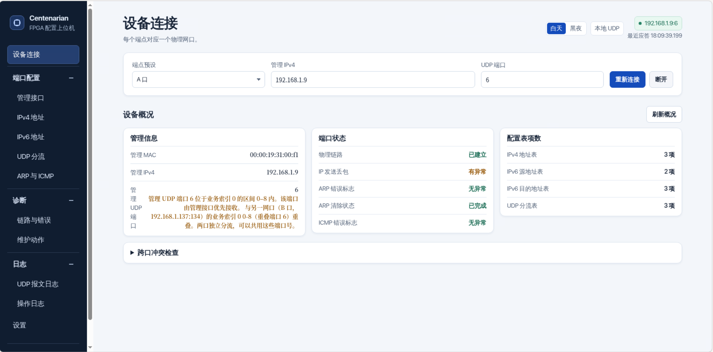
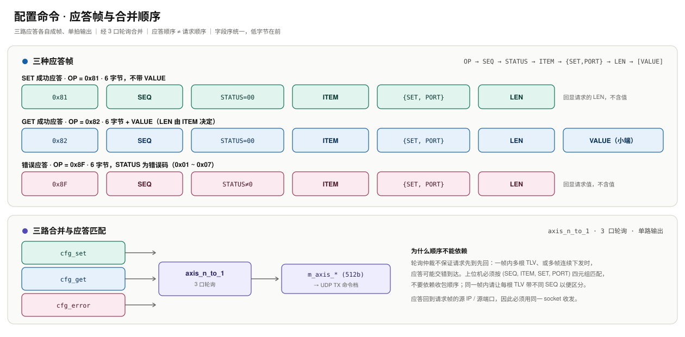

# 单口 UDP 配置协议

管理命令通过 UDP(IPV4) 收发。

## 用网页读写配置



在仓库根目录启动上位机，需要 Python 3.10 或更新版本。以下命令会打开网页并连接虚拟 A 口。

```sh
python -B Tools/PortConfig/server.py --demo --open
```

连接实板前，下载位流、接通网口，并为主机网卡设置与板口管理 IPv4 同网段的未占用地址，例如 `192.168.1.100/24`。如果演示服务正在运行，先按 Ctrl+C 停止，再启动实板模式。

```sh
python -B Tools/PortConfig/server.py --open
```

浏览器未自动打开时，访问 `http://127.0.0.1:8770/`。若本机网页端口已被占用，可在启动命令末尾加 `--port 8771`，并改用对应网页地址。

1. 在「设备连接」选择 A/B 预设，或输入管理 IPv4 和 UDP 端口。点击「连接设备」，再用「刷新概况」核对管理地址和链路状态。 [参考端点](02-configuration.md#参考设计默认值)
2. 在对应的配置页面修改目标配置项，点击「确定」，确认读回值与输入一致。
3. 修改管理 IPv4 或 UDP 端口后，在新端点核对管理 MAC。若连接未恢复，在「设备连接」探测旧端点和新端点。恢复默认值后，按该网口的默认端点重新连接。

无应答时，先检查链路、主机网段和目标端点，再从「日志 → UDP 报文日志」查看请求和应答。

## 处理流程


## 帧格式

每条请求的 UDP 载荷为 22 字节，应答为 23 字节。前两字节为 `19 31`。字节偏移 2 的高 5 位是序号，低 3 位是操作码。应答操作码为 4，沿用请求的序号、配置项和索引。




`GET=1` 和 `EXEC=3` 的有效值长度填 0。`SET=2` 按配置项填写有效值长度，将值放在值区开头，其余字节补 0。只有成功的 `GET` 应答包含有效值。长度或标识不符的请求会被丢弃。

| 状态 | 含义 |
| --- | --- |
| `0x00 OK` | 操作成功 |
| `0x01 BAD_OP` | 操作码无效 |
| `0x02 BAD_ITEM` | 配置项不存在 |
| `0x03 BAD_INDEX` | 索引越界，标量和动作使用索引 0 |
| `0x04 ACCESS_DENIED` | 该项不支持请求的操作 |
| `0x05 BAD_VALUE_LENGTH` | 有效值长度错误 |

## 配置项

下表字节数用于 `SET` 的有效值或成功 `GET` 的返回值。表项索引从 0 开始，表深度见[参数和默认值](02-configuration.md)。

| 编号 | 配置项 | 操作 | 字节数 | 值或作用 |
| --- | --- | --- | --- | --- |
| `0x10` | `MGMT_MAC_ADDR` | GET/SET | 6 | 本口管理 MAC |
| `0x11` | `MGMT_IPV4_ADDR` | GET/SET | 4 | 本口管理 IPv4 |
| `0x12` | `MGMT_UDP_PORT` | GET/SET | 2 | 本口请求接收端口 |
| `0x13` | `LINK_STATE` | GET | 1 | bit 0 为链路就绪 |
| `0x14` | `IP_TX_DROP_FLAGS` | GET | 1 | bit 0 为 IPv4、bit 1 为 IPv6 发送丢包 |
| `0x15` | `CLEAR_PORT_FLAGS` | EXEC | 0 | 清除本口 IP、ARP 和 ICMP 错误标志 |
| `0x16` | `RESTORE_PORT_DEFAULTS` | EXEC | 0 | 恢复本口寄存器默认值，可能改变管理端点 |
| `0x20–0x23` | `IPV4_LOCAL_IP`、`IPV4_LOCAL_MAC`、`IPV4_GATEWAY`、`IPV4_MASK` | GET/SET | 4 / 6 / 4 / 4 | 本口业务 IPv4 表 |
| `0x24` | `ARP_PENDING_TIMEOUT_MS` | GET/SET | 8 | 毫秒，无符号小端，保存低 `PendingTimeWidth` 位 |
| `0x25` | `ARP_TX_PRIORITY` | GET/SET | 1 | ARP 数值优先级，保存低 `ReqWidth` 位 |
| `0x26` | `ARP_ERROR_FLAGS` | GET | 1 | bit 0–3 依次为接收错误、应答 FIFO 溢出、待决 FIFO 溢出、查询源 IP 非本机 |
| `0x27` | `ARP_CLEAR_STATE` | GET | 1 | bit 0、bit 1 分别为缓存、待决解析清除完成 |
| `0x28` | `ARP_CLEAR_CACHE` | EXEC | 0 | 发起 ARP 缓存清除 |
| `0x29` | `ARP_CLEAR_PENDING` | EXEC | 0 | 发起 ARP 待决解析状态清除 |
| `0x2A` | `ARP_ANNOUNCE_MASK` | GET/SET | 1–16 | 索引为 0，整份掩码低字节先传 |
| `0x2B` | `ARP_ANNOUNCE_SEND` | EXEC | 0 | 索引为 0，锁存当前掩码，覆盖尚未被发送模块接收的请求 |
| `0x2C` | `ICMP_ECHO_PRIORITY` | GET/SET | 1 | ICMPv4 回显回复优先级，保存低 `ReqWidth` 位 |
| `0x2D` | `ICMP_ERROR_FLAGS` | GET | 1 | bit 0 为 TTL 错误 |
| `0x2E` | `UDP_IPV4_RX_PORT_RANGE` | GET/SET | 4 | UDP(IPV4) 目的端口下界、上界，各 2 字节 |
| `0x2F` | `UDP_IPV6_RX_PORT_RANGE` | GET/SET | 4 | UDP(IPV6) 目的端口下界、上界，各 2 字节 |
| `0x40–0x43` | `IPV6_SRC_IP`、`IPV6_SRC_MAC`、`IPV6_DST_IP`、`IPV6_DST_MAC` | GET/SET | 16 / 6 / 16 / 6 | IPv6 源、目的表的 IP 或 MAC |
