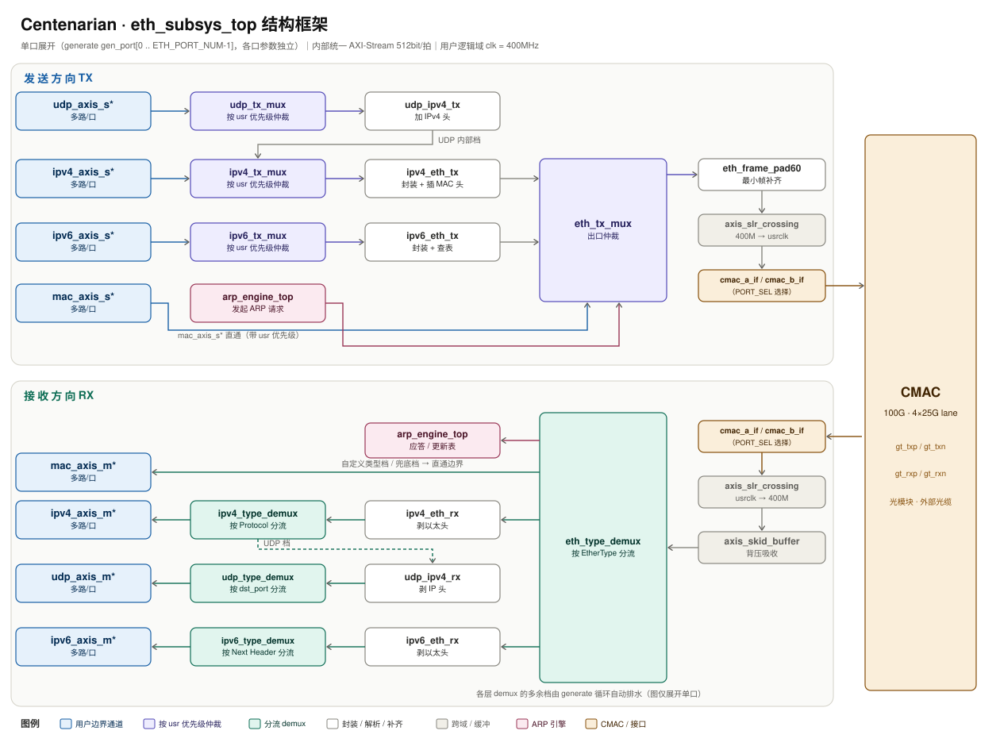

<div align="center">

# Centenarian

**面向 Xilinx UltraScale+ 的可扩展 100G 以太网协议子系统 IP**

把 CMAC 的裸以太网帧按协议类型整理成一条条独立的流式通道，并自动完成地址解析、报文封装与发送调度 —— 上层只需要对接标准的 AXI-Stream 接口。

    



</div>

## 目录

- [Centenarian](#centenarian)
  - [目录](#目录)
  - [特性](#特性)
  - [快速开始](#快速开始)
    - [环境要求](#环境要求)
    - [依赖 IP](#依赖-ip)
    - [创建工程](#创建工程)
    - [参考实测结果](#参考实测结果)
  - [用法](#用法)
    - [最小例化（单网口）](#最小例化单网口)
    - [常用参数](#常用参数)
  - [文档](#文档)
  - [FAQ](#faq)
  - [许可证](#许可证)
  - [贡献](#贡献)
  - [Star History](#star-history)

---

## 特性

- **按协议类型自动分发** —— 以太网按帧类型、IPv4 按协议号、IPv6 按下一头部类型、UDP 按目的端口区间，各自分发到独立通道；每种分发都附带一条"未匹配"通道，用来收下不属于任何规则的报文，既不会丢包也不会堵塞其它通道
- **每个网口配置独立** —— 端口数量、各协议的分发规则、UDP 端口区间、超时与发送优先级都可逐口单独设置，各网口互不影响
- **全流水线、无空拍** —— 用户时钟 **200 MHz** 与 **400 MHz** 两种主频下均测试通过，可跑满 100G 线速（带宽计算见 [01 · 架构与模块](Docs/01-architecture.md)，实测记录见 [04 · 验证与测试](Docs/04-verification.md)）
- **400 MHz 用户域已实测收敛** —— 在 VU37P 上完成布局布线，用户时钟域（400 MHz）**无任何时序违例**，全部约束满足（实测余量与资源占用见[安装节](#安装)的参考实测结果）
- **发送按优先级调度** —— 每条发送通道带一个**位宽可配置**的优先级标记：高优先级先发，同级轮流发送，一帧发完才切换，不会打断帧
- **地址解析不阻塞发送** —— 内置 ARP 协议引擎自动完成地址查询、学习，以及应答的缓存与等待队列管理；地址查询与数据通路**并行**处理，IPv4 帧获取MAC地址**无需等待查表结果**，相邻帧可**背靠背连续发送、帧间无需反压**；解析未命中时按策略丢弃该帧并计入统计，不阻塞后续帧
- **IPv6 地址表** —— 发送时按目的 / 源地址表填充链路层地址，不匹配源和目的包直接丢弃并给出统计
- **规模可伸缩** —— 网口数量、每类通道数量都能按需扩展：边界位宽由统一的宽度参数决定，新增端口或通道不会打乱已有端口的接口编号与布局约束
- **纯 Verilog-2001，全流式接口** —— 模块之间统一使用 AXI-Stream（512 位 / 拍），可任意插入 FIFO 或寄存器级

**未实现（请知悉）**

- 不做 IPv6 邻居发现（NDP）：使用IPV6地址表获取MAC地址，ICMPv6 报文只会被送到对应通道交给下游处理；
- 不做 IPv4 / IPv6 首部校验和的计算与校验；
- **长帧会挡住后面的短帧**：发送是以「整帧」为单位调度的，某条通道拿到发送权后会一直发到这帧结束才让出；期间到达的高优先级短帧只能等它发完。项目没有做抢占或分片之类的规避机制。

---

## 快速开始

### 环境要求

| 依赖                | 版本                      | 说明                                     |
| ----------------- | ----------------------- | -------------------------------------- |
| AMD/Xilinx Vivado | 2025.2                  | 需包含 UltraScale+ 器件支持                   |
| 器件                | `xcvu37p-fsvh2892-2L-e` | 4 个 SLR；换器件需重新定制 CMAC 与约束              |
| 仿真器               | Vivado `xsim`           | `xvlog` / `xelab` / `xsim`，随 Vivado 安装 |

### 依赖 IP

`cmac_usplus`(v3.1) ×2、`axis_slr_crossing`（跨 SLR 寄存）、`VIO (Virtual Input/Output) (3.0)`。

仓库已提交 `.xci` 配置，脚本直接复用，**不需要手工定制**。

> 1. cmac_usplus ip需要用户申请许可证后方可使用，具体参考[UltraScale+™ Integrated 100G Ethernet Subsystem 许可证获取](https://www.amd.com/zh-cn/products/adaptive-socs-and-fpgas/intellectual-property/cmac_usplus.html)
> 2. 用户时钟（400 MHz）与 GT 参考时钟由**你的板级时钟方案**提供，不属于本 IP 的依赖；仓库的板级示例使用 `clk_wiz` 从 100 MHz 倍频产生 400 MHz，请结合自身板卡更改时钟源和约束；

### 创建工程

**目录约定**：源码放在一个目录里（下称“源码目录”，本项目约定命名为 `Centenarian.user`），Vivado 工程创建在它的**上一层**：

```text
<工作区>/                      ← 外层：工程建在这里（xpr / runs / cache / gen …）
├── Centenarian.xpr
└── Centenarian.user/          ← 内层：只有源码（RTL / TB / XDC / IP / Docs / Scripts）
    ├── RTL/  TB/  XDC/  IP/  Docs/
    ├── Scripts/create_project.tcl
    └── TB/README.md                    ← 仿真 TB 索引（被测模块 / 覆盖点 / 运行方式）
```

执行以下命令，即可建好工程并开始综合：

```bash
mkdir Centenarian
cd Centenarian
git clone https://github.com/Magnus-42/Centenarian.git Centenarian.user   # 克隆为“源码目录”
vivado -mode batch -source Centenarian.user/Scripts/create_project.tcl -tclargs -top subsys_test_top -jobs 8 -synth
```

脚本会：在**外层**创建工程（器件 `xcvu37p-fsvh2892-2L-e`，工程名默认取外层目录名）→ 加入源码目录下的全部 RTL 与 XDC → 导入已提交的 IP 配置（`IP/*/*.xci`）→ 生成 IP 输出产物 → 设顶层 → 启动 `synth_1`。

脚本参数：

| 参数       | 含义                         | 默认值               |
| -------- | -------------------------- | ----------------- |
| `-top`   | 综合顶层                       | `subsys_test_top` |
| `-jobs`  | 并行线程数                      | `4`               |
| `-synth` | 建完工程后启动综合                  | 关闭                |
| `-ooc`   | IP 生成后额外跑 OOC 综合（很慢）       | 关闭                |
| `-name`  | 工程名（默认取外层目录名）              | 外层目录名             |
| `-force` | 外层已有同名工程时删除重建（会丢弃 runs 结果） | 关闭（默认中止保护）        |

---

### 参考实测结果

VU37P 上完整实现（Vivado 2025.2，顶层 `subsys_test_top`，含全部打流机与 VIO，未插入 ILA）：

| 项目               | 实测值                                                                                                                                                   |
| ---------------- | ----------------------------------------------------------------------------------------------------------------------------------------------------- |
| 用户时钟（400 MHz）WNS | **+0.006 ns**                                                                                                                                         |
| 用户时钟 WHS         | **+0.010 ns**                                                                                                                                         |
| TNS / 违例端点       | 0.000 ns / **0**（用户时钟域共 161 312 个端点）                                                                                                                  |
| THS / 违例端点       | 0.000 ns / **0**（共 161 216 个端点）                                                                                                                       |
| 脉冲宽度 WPWS / TPWS | +0.454 ns / 0 违例                                                                                                                                      |
| 整体结论             | **All user specified timing constraints are met**                                                                                                     |
| 布线               | 82 285 条 net **全部布线完成**，0 布线错误                                                                                                                        |
| DRC（routed）      | 0 违例                                                                                                                                                  |
| 线速实测             | **200 MHz** 与 **400 MHz** 两种主频下均跑满 100G 线速 —— MAC、IPv4（192 / 256 / 512 / 1024 字节）、UDP 双向、全栈严格优先级四阶段上板打流（分阶段数据见 [04 · 验证与测试](Docs/04-verification.md)） |
| CLB LUTs         | 24 067（1.85%）                                                                                                                                         |
| CLB Registers    | 63 902（2.45%）                                                                                                                                         |
| Block RAM Tile   | 80（3.97%）：RAMB36 70、RAMB18 20                                                                                                                         |
| DSP / URAM       | 0 / 0                                                                                                                                                 |

即相当于用户时钟从 100 MHz 倍频到 400 MHz、并保留 VIO 调试核的情况下，时序仍然收敛（余量 +0.006 ns 为正）。

**线速口径**：本项目的 100G 线速按「AXIS 帧长 + 以太网开销」记账 —— CMAC 配置为发送插入 FCS、接收剥离 FCS，因此 AXI-Stream 上看到的帧不含 FCS；单帧 AXIS 长度为 `L` 字节时，线上还要再算 8 字节前导码与起始符、4 字节 FCS、12 字节帧间隔，共 `L + 24` 字节：

```text
线速 = 总线（AXIS）吞吐 × (L + 24) / L
```

1024 字节帧 ⇒ 系数 `1048 / 1024 = 1.0234`，即 **100G 线速对应总线侧 97.7 Gbps**  
（上述 `+24` 是 MAC 层帧的口径；IPv4 / IPv6 帧还要多 14 字节以太网首部 ⇒ `+38`，UDP 载荷还要再加 20 字节 IPv4 首部 ⇒ `+58`，逐层次的口径与实测折算见 [04 · 验证与测试](Docs/04-verification.md)）。以上数据来自 VU37P 上的完整实现（顶层 `subsys_test_top`）；可用[快速开始](#快速开始)的脚本建好工程后自行综合与实现。

---

## 用法

### 最小例化（单网口）

```verilog
eth_subsys_top #(
  .ETH_PORT_NUM        (1),
  .CFG_NUM_WIDTH       (8),
  // 单网口：每个配置参数只填一段
  .MAC_RX_TYPE_NUM_ARR    ({ {8{1'b0}}|4'd1 }),
  .MAC_RX_TYPE_DICT_ARR   (16'hB588),
  .MAC_TX_TYPE_NUM_ARR    ({ {8{1'b0}}|4'd1 }),
  .IPV4_RX_TYPE_NUM_ARR   ({ {8{1'b0}}|4'd3 }),
  .IPV4_RX_TYPE_DICT_ARR  ({8'h06, 8'h59, 8'h01}),
  .IPV4_TX_TYPE_NUM_ARR   ({ {8{1'b0}}|4'd3 }),
  .IPV6_RX_TYPE_NUM_ARR   ({ {8{1'b0}}|4'd3 }),
  .IPV6_RX_TYPE_DICT_ARR  ({8'h59, 8'h3A, 8'h11}),
  .IPV6_TX_TYPE_NUM_ARR   ({ {8{1'b0}}|4'd3 }),
  .UDP_RX_PORT_NUM_ARR    ({ {8{1'b0}}|4'd3 }),
  .UDP_DST_PORT_RANGE_ARR ({32'h00080002, 32'h00010001, 32'h00000000}),
  .UDP_TX_PORT_NUM_ARR    ({ {8{1'b0}}|4'd8 }),
  .CFG_PENDING_TIME_ARR   (57'd400_000_000)
) u_dut (
  .sys_clk   (sys_clk),
  .clk       (clk_400m),
  .gt_txp_out(gt_txp_out), .gt_txn_out(gt_txn_out),
  .gt_rxp_in (gt_rxp_in ), .gt_rxn_in (gt_rxn_in ),
  // UDP 层（其余三类通道同构：把 udp_ 换成 mac_ / ipv4_ / ipv6_）
  .udp_axis_mdata (udp_rx_data ), .udp_axis_mkeep (udp_rx_keep ),
  .udp_axis_mlast (udp_rx_last ), .udp_axis_mvalid(udp_rx_valid),
  .udp_axis_mready(udp_rx_ready),
  .udp_axis_sdata (udp_tx_data ), .udp_axis_skeep (udp_tx_keep ),
  .udp_axis_slast (udp_tx_last ), .udp_axis_svalid(udp_tx_valid),
  .udp_axis_sready(udp_tx_ready),
  .udp_axis_susr  (udp_tx_usr  )
);
```

多网口时，把每个 `*_ARR` 按「口 0 在低位、后续口依次向高位」拼接即可，其余代码不变。

### 常用参数

| 参数                       | 含义                    | 备注                                                   |
| ------------------------ | --------------------- | ---------------------------------------------------- |
| `ETH_PORT_NUM`           | 网口数                   | 最小为 1；加口 = `+1` 并在各 `*_ARR` 高位拼一段                    |
| `PRIORITY_WIDTH`         | 优先级标记位宽               | 默认 4；`*_axis_susr` 位宽 = `PRIORITY_WIDTH` × 通道数 × 网口数 |
| `CFG_NUM_WIDTH`          | 计数项位宽                 | 单个端口的通道数上限 `2^N - 1`                                 |
| `*_RX_TYPE_NUM_ARR`      | 每口接收通道数               | 不含内部通道与"未匹配"通道                                       |
| `*_RX_TYPE_DICT_ARR`     | 每口的分发规则表              | 书写序最右 = ch0；小端序                                      |
| `*_TX_TYPE_NUM_ARR`      | 每口发送通道数               | 与 `*_axis_susr` 一一对应                                 |
| `UDP_DST_PORT_RANGE_ARR` | 每口 UDP 端口区间 `[hi,lo]` | 区间不可重叠                                               |
| `CFG_PENDING_TIME_ARR`   | 每口 ARP 待发超时           | 单位为用户时钟周期                                            |

完整参数表、位宽公式与配置示例见 [Docs/02-configuration.md](Docs/02-configuration.md)。

---

## 文档


| 文档                                     | 内容                                |
| -------------------------------------- | --------------------------------- |
| [00 · 文档索引](Docs/00-index.md)          | 文档地图与阅读路径                         |
| [01 · 架构与模块](Docs/01-architecture.md)  | 分层结构、模块职责、发送调度、性能指标               |
| [02 · 参数与配置](Docs/02-configuration.md) | 参数体系、分发规则书写、两个完整配置示例              |
| [03 · 集成指南](Docs/03-integration.md)    | 端口位宽公式、时钟复位、约束、集成自检               |
| [04 · 验证与测试](Docs/04-verification.md)  | `subsys_test_top` 验证环境、脚本化验证与实测记录 |
| [TB 目录说明](TB/README.md)                | 每个仿真 TB 的被测模块、覆盖内容、运行方式与判定标准      |

上板验证脚本：[`Scripts/hw_ila_vio.tcl`](Scripts/hw_ila_vio.tcl) —— 下载 bit 与 ltx 后 `source ./Scripts/hw_ila_vio.tcl`，即可用 `hw_run sc1` ~ `hw_run sc4` 逐场景自动完成「设使能 → 采集 ILA → 判定」（用法与判定依据见 [04 · 验证与测试](Docs/04-verification.md)）。

---

## FAQ

**Q1：分发规则配好了却匹配不上，报文全落到"未匹配"通道？**

A：配置字段是小端序，且总线最右端字节 = 线上第一个字节。`0x0800` 要写成 `16'h0008`。见 [02 · 参数与配置](Docs/02-configuration.md) 的「分发规则书写规则」。

**Q2：某一类协议完全用不到，可以关掉吗？**

A：可以，把该口的这类通道数配成 `0` 即可：该端口不再启用这类通道，不接收也不参与发送仲裁，不需要改代码或加条件编译。见 [02 · 参数与配置](Docs/02-configuration.md)。

**Q3：能支持 IPv6 邻居发现吗？**

A：**当前不支持**。子系统只做按"下一头部类型"的分发和地址表查表，ICMPv6 报文会送到对应通道，邻居发现需要在你自己的上层逻辑里实现。

**Q4：换器件（不是 VU37P）能用吗？**

A：可以，但需要重新定制 CMAC IP、调整 `eth_top` 的 lane 绑定与全部引脚、时钟、pblock 约束，并重新评估时序 —— 上文的时序裕量只在 VU37P 上实测过。

---

## 许可证

GNU 通用公共许可证 v3.0。详情请参阅 [LICENSE](LICENSE)。  
这意味着：

- 可自由使用、修改和分发
- 衍生作品必须以相同许可证开源
- 必须保留原始版权声明

---

## 贡献

- 问题反馈与讨论：**GitHub Issues**（本仓库 Issues 页）

欢迎提交 Issue 与 Pull Request：

- Bug 请附：器件 / Vivado 版本、顶层、参数配置、复现步骤与关键日志；
- 功能建议请先开 Issue 讨论接口与参数命名，再动手实现；
- 提交前请跑一次实现流程，确认用户域无时序违例。

## Star History

<a href="https://www.star-history.com/?repos=magnus-42%2Fcentenarian&type=date&legend=top-left">
  <picture>
    <source media="(prefers-color-scheme: dark)" srcset="https://api.star-history.com/chart?repos=magnus-42/centenarian&type=date&theme=dark&legend=top-left" />
    <source media="(prefers-color-scheme: light)" srcset="https://api.star-history.com/chart?repos=magnus-42/centenarian&type=date&theme=light&legend=top-left" />
    
  </picture>
</a>
