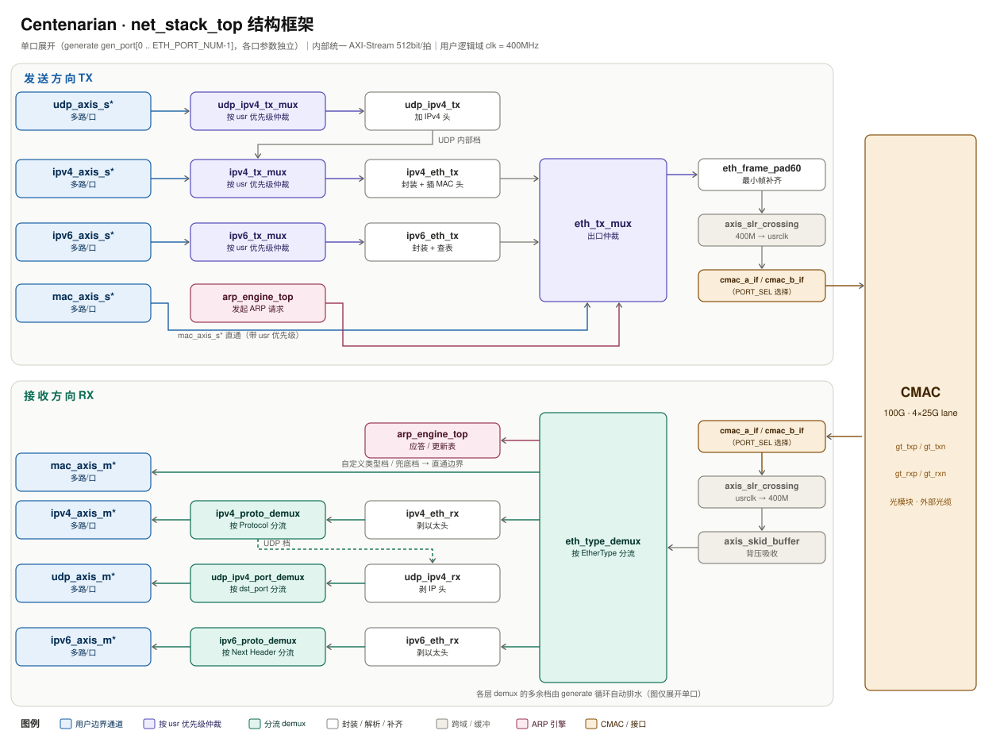

<h1 align="center">Centenarian</h1>
<p align="center">面向 AMD/Xilinx UltraScale+ 的 100GbE FPGA 协议栈，通过 512 位 AXI-Stream 将 QSFP 上的以太网流量接入业务 RTL。</p>
<p align="center">
  <a href="#创建参考工程"></a>
  <a href="#创建参考工程"></a>
  <a href="LICENSE"></a>
</p>

[创建工程](#创建参考工程) · [接入业务 RTL](Docs/03-integration.md) · [配置端口](Docs/05-config-command.md#用网页读写配置) · [上板验证](Docs/04-verification.md) · [文档索引](Docs/00-index.md)

## 数据通路

参考工程提供 A/B 两个 100GbE 物理口。每口提供 MAC、IPv4/IPv6、ICMPv4 和 UDP 载荷接口，并有独立的 UDP 管理端点。各层业务收发均使用本层载荷，首部字段通过 `usr` 传递；封装和解封装由对应协议层完成。

[](Docs/01-architecture.md)

## 目录

| 目录 | 内容 |
| --- | --- |
| [RTL](RTL)、[IP](IP)、[XDC](XDC) | RTL、IP 配置和板级约束 |
| [TB](TB)、[Scripts](Scripts) | 仿真测试和 Vivado 脚本 |
| [Tools](Tools) | 配置上位机 |
| [Docs](Docs/00-index.md) | 集成、配置和上板验证 |

## 创建参考工程

需要 Git、Vivado 2025.2、`xcvu37p-fsvh2892-2L-e` 器件支持和 CMAC IP 许可。

在工作区的上一级目录执行以下命令。Windows 可将 `vivado` 换成 `vivado.bat`。

```sh
mkdir Centenarian
cd Centenarian
git clone https://github.com/Magnus-42/Centenarian.git usr
vivado -mode batch -source usr/Scripts/create_project.tcl -tclargs -top subsys_test_top -name My100G
```

已有仓库时，从仓库的上一级目录执行最后一条命令，将 `usr` 换成仓库目录名。同名工程已存在时，打开已有工程或通过 `-name` 指定新名称。

日志出现「工程已创建」后，打开工作区中的 `My100G.xpr`，确认综合顶层为 `subsys_test_top`。 [参考板打流](Docs/04-verification.md)

## 选择集成入口

| 目标 | RTL 入口 |
| --- | --- |
| 接入一个 100GbE 物理口 | [`eth_stack_port`](RTL/Top/eth_stack_port.v) |
| 复用参考设计的 A/B 两口封装 | [`eth_stack_top`](RTL/Top/eth_stack_top.v) |
| 在参考板上用内置打流机和 VIO/ILA 验证 | [`subsys_test_top`](RTL/Test/Top/subsys_test_top.v) |

先确定通道数和分流规则，再按单路位宽连接总线。 [接线与约束](Docs/03-integration.md) · [参数和默认值](Docs/02-configuration.md)

## 配置板上端口

用网页查询链路状态、修改地址或 UDP 分流区间。没有板卡时可运行演示模式。 [网页操作步骤](Docs/05-config-command.md#用网页读写配置) · [客户端接入协议](Docs/05-config-command.md#帧格式)

## 许可证

GNU General Public License v3.0。 [LICENSE](LICENSE)

## Star History

<a href="https://www.star-history.com/?repos=magnus-42%2Fcentenarian&type=date&legend=top-left">
  <picture>
    <source media="(prefers-color-scheme: dark)" srcset="https://api.star-history.com/chart?repos=magnus-42/centenarian&type=date&theme=dark&legend=top-left" />
    
  </picture>
</a>
